<table>
<tr>
<td width="62%" valign="top">

### 🧑‍💻 About Me

- 🏢 **Backend Developer** at **Ithinka** — building a multi-tenant HR SaaS with **.NET & ABP Framework**
- ⚙️ Designed a generic **Approval Workflow engine** with **DDD** and **event-driven** communication over **RabbitMQ**
- 🔬 Built a **multimodal semantic search engine** for histopathology — **+65.6% Precision@10** over 114K images
- 🎓 **Computer Engineering** graduate · TÜBİTAK 2209-B supported research
- 🌱 Currently learning: **Docker, Kubernetes, CI/CD, AWS, Terraform**
- 📍 Bursa, Türkiye

</td>
<td width="38%" align="center">

</td>
</tr>
</table>

### 🛠️ Tech Stack

**Backend** 

**Frontend** 

**AI / ML** 

**DevOps & Tools** *(learning 🌱)* 

### 🚀 Featured Projects

| Project | Description | Stack |
|---|---|---|
| 🔬 **Histopathology Semantic Search** | Text-to-image search over 114K images with vision-language models. Precision@10: 0.395 → 0.654, ~115 ms queries. Novel *Text-Anchor Domain Gate* for the modality gap. | PyTorch · OpenCLIP · FAISS · Streamlit |
| ✅ **Approval Workflow Engine** | Reusable multi-step approval module for a multi-tenant HR SaaS — delegation, gapped steps, optimistic concurrency. | .NET · ABP · DDD · RabbitMQ |

<!-- Kendi repo linklerini eklemek için proje adını şöyle yap: [**Proje Adı**](https://github.com/CagriCelikkoll/repo-adi) -->

### 📊 GitHub Stats

 

### 🤝 Connect

